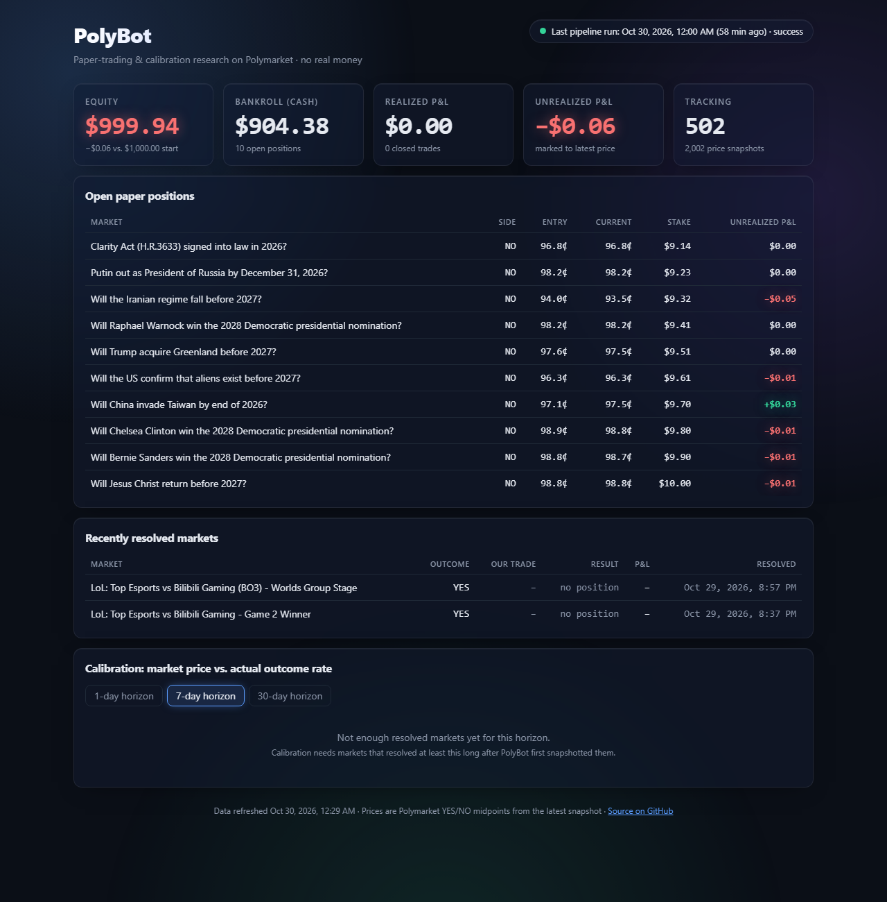
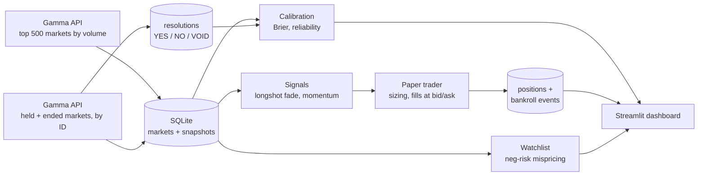

# PolyBot

[](https://github.com/JayZhangDev/PolyBot/actions/workflows/ci.yml)


PolyBot is a research project on [Polymarket](https://polymarket.com) prediction markets. It started as a data pipeline and a rule-based paper trader, and **v2 adds an autonomous agent** that estimates its own probabilities, sizes bets with the Kelly criterion, and learns from how markets resolve. Everything is paper trading; no real money is ever used.

The core question throughout is **how well prediction-market prices forecast outcomes, and whether a disciplined model can find mispricings**. The v1 calibration tracker scores market prices against outcomes; the v2 agent asks whether any market is priced far enough from a calibrated estimate to be worth a bet, and logs every decision so the answer is auditable.

## Evolution: from pipeline to agent

| Version | What it added | What it can do |
|---|---|---|
| **v0.0** | Gamma API fetcher, SQLite snapshots | Record market prices over time |
| **v0.1** | Paper trader, longshot and momentum rules, dashboard | Trade fixed rules once an hour with a flat 1% stake |
| **v0.1.1** | Executable prices (bid/ask), settlement fixes, tests, CI | Honest fills and correct P&L |
| **v0.2** | Calibration tracker | Measure how well prices predict outcomes (Brier, reliability) |
| **v2.0** | **Autonomous agent** ([`polybot/agent.py`](polybot/agent.py)) | Every 10 minutes: estimate probability per market, rank by edge, size with half-Kelly under a hard risk cap, log every decision, learn from resolutions |
| **v2.1** | Hardening: retries, run lock, rotating log, `polybot health` | Ride out API errors, record every run, and show at a glance whether data is still arriving |
| **v2.2** | Market catalog, tag-based categories, `config.yaml` | Know every open market above the floors, and choose which ones to stream |
| **v2.3** | Live websocket recorder ([`polybot/streamer.py`](polybot/streamer.py)) | Record order books and every trade for the selected markets as they happen |
| **v2.4** | Warehouse: Parquet files queried with DuckDB, daily rollup | Keep months of live data small, and answer questions over all of it in well under a second |
| **v2.5** | Calibration tracker, `models/` folder, report with charts | Score the market's prices by horizon and category, and score any model against the market |
| **v2.6** | PAPER ledger: fills at the recorded bid and ask, depth, fees, status file | Trade a model's opinions with fake money as honestly as the recorded books allow |

The hourly pipeline is unchanged. The agent runs beside it, shares its market, snapshot and resolution tables, and keeps its own positions and bankroll so the two strategies can be compared cleanly. The git history shows each step.

[](https://jayzhangdev.github.io/PolyBot/)

**[Live dashboard →](https://jayzhangdev.github.io/PolyBot/)**

## How it works



Each hourly cycle (`python -m polybot.pipeline`):

1. **Snapshot.** Fetch the 500 highest-volume open markets and store price, bid/ask, volume and liquidity.
2. **Refresh held markets.** Any market with an open paper position that wasn't in that set (usually because it closed) is fetched by ID, so resolutions are always seen.
3. **Record resolutions.** Up to 50 markets that have ended (or dropped out of the listing) are fetched by ID; closed ones are stored as YES, NO or VOID.
4. **Settle.** Positions in closed markets settle at $1 or $0 per share; the bankroll is credited.
5. **Trade.** New signals open positions at executable prices (YES at the ask, NO at 1 − bid), 1% of bankroll each, up to 10 open positions and 3 new per strategy per cycle.

## Calibration: how good are the prices, and can a model beat them?

A price of 0.30 is the market saying "30% chance". The market is *calibrated* if, across many markets priced near 0.30, about 30% really resolve YES. The tracker ([`polybot/tracker.py`](polybot/tracker.py)) takes every resolved market's price **1 day** and **7 days** before it was decided and compares it with what happened:

- **Brier score**: the average of (probability − outcome)², with the outcome 1 for YES and 0 for NO. 0 is perfect, always saying 50% scores 0.25, lower is better.
- **Calibration curve**: markets grouped into ten price buckets; for each, the average price against the share that resolved YES. A calibrated market sits on the diagonal.
- **By category**: the same score split by Polymarket's own categories, which come from each market's tags.

```bash
python -m polybot calibrate     # rebuild the report from the warehouse (the daily rollup also does this)
```

It writes `reports/calibration.md` (summary tables), `reports/calibration_1d.png`, `reports/calibration_7d.png`, two `brier_by_category_*.png` charts and a small `calibration.json` that `polybot health` reads. `reports/` is generated output and is not in git.

**Rules that keep the scoring honest.**

- "Decided" is the earlier of the market's close and the first snapshot already at 99% or more for the winning side, so a market everyone considered settled is not scored on those late prices.
- The price must have been recorded in the day before the cut-off. A market PolyBot had stopped watching is left out rather than scored on a stale price.
- VOID markets are left out.

### Adding your own model

Each `.py` file in [`models/`](models/) is one model: a `NAME` and a `predict(market)` function that returns a probability. The tracker asks every model for a probability on every resolved market, shows it only what was known at that moment (price, bid and ask, volume, liquidity, days left, the last day's price change, category, question), and compares its Brier score with the market's **on the same markets**.

```python
NAME = "my_model"
DESCRIPTION = "One sentence on the idea being tested."


def predict(market: dict) -> float | None:
    return market["price"]          # returning the price scores exactly like the market
```

Two examples ship with the repo: `favorite_longshot.py` (pushes each price a little further from 50%) and `momentum_24h.py` (adds half of the previous day's move). See [`models/README.md`](models/README.md) for the full contract.

A model gets no verdict until it has been scored on 100 markets, and after that the report only says "ahead of the market so far" when its gain is more than twice its standard error. Markets that resolve together are not independent, so even that is a reason to keep watching, not a result.

The older module `polybot/calibration.py` (30-day horizon, longshot check) is unchanged; the agent's learning loop and the dashboard still read it.

## PolyBot v2: the autonomous agent

`python -m polybot.agent` runs one cycle; a scheduled task runs it every 10 minutes ([setup](#running-the-agent-every-10-minutes-windows--wsl)).

```mermaid
flowchart LR
    A[Gamma API<br/>2,000 active markets] --> F[Filter<br/>liquidity > $10k<br/>> 7 days left]
    F --> E[Estimator<br/>base rate + recency<br/>x category trust]
    E --> R[Rank by edge<br/>abs&#40;edge&#41; > 8%]
    R --> K[Half-Kelly sizing<br/>6% cap, 10 positions]
    K --> X[(agent_positions<br/>agent_decisions)]
    X --> L[Learning loop<br/>on resolution]
    L --> P[(agent_priors<br/>agent_performance)]
    P --> E
    X --> D[Dashboard<br/>Agent tab]
```



### 1. Scan and filter
Each cycle pulls up to 2,000 active markets (highest volume first) and keeps those with more than **$10,000 liquidity** and more than **7 days** to resolution. Eligible markets are snapshotted every 10 minutes, which gives the recency signal real price history.

### 2. Probability estimation
For each market the agent builds an ensemble estimate from three parts:

1. **Base rate (category-calibrated).** The market price is passed through a per-category calibration curve, `sigmoid(gamma * logit(price))`. `gamma = 1` means prices are calibrated; the prior `gamma = 1.1` encodes the documented favorite-longshot bias (longshots are overpriced, favorites underpriced). Markets are classified as politics, crypto, sports, science or other.
2. **Recency signal.** The price plus half of its last-24-hour move (momentum continuation). With no 24-hour history the signal equals the price and adds no edge.
3. **Calibration prior (trust).** The blend `0.6 * base + 0.4 * recency` is shrunk toward the market price by a per-category *trust* weight: `estimate = market + trust * (blend - market)`. Trust starts at 0.7 and, once 20 agent forecasts in a category have resolved, follows that category's Brier skill against the market.

The output for each market is `estimated_prob`, `market_prob` and `edge = estimated_prob - market_prob`.

### 3. Opportunity filter
Only markets with `abs(edge) > 8%` are considered, ranked by edge size.

### 4. Kelly sizing
Buying a binary share at price `c` with win probability `q` has Kelly fraction `(q - c) / (1 - c)` (edge divided by `1 - c`; equivalent to `(b*q - (1-q)) / b` with net odds `b = (1-c)/c`). The agent bets **half-Kelly**, **never more than 6% of bankroll on one market**, and **never more than 10 open positions**. `c` is the executable price (YES at the ask, NO at 1 - bid), so a trade whose edge is eaten by the spread is skipped.

### 5. Paper execution and audit trail
Every considered trade is written to `agent_decisions` (timestamp, market, question, market probability, estimate, edge, Kelly stake, action, reason, plus the estimator components as JSON). A position opens only if all rules pass; otherwise the reason is logged (`max_positions_reached`, `edge_consumed_by_spread`, `insufficient_cash`, and so on). A repeat skip for the same market is logged at most once every 6 hours so the log stays readable. Nothing is sent to any exchange.

### 6. Learning loop
Each cycle the agent first settles positions whose markets resolved (a winning share pays $1, VOID refunds the stake). It then refits each category's `gamma` on resolved markets by regularised log-loss (thin categories stay near the prior), updates trust, and writes `agent_performance` rows: agent vs market **Brier score**, **Brier skill** and **edge capture** (realized edge divided by predicted edge), by category.

### Findings so far

- **At the specified 8% threshold the agent finds nothing, and that is the honest result.** Across the first scans of about 1,300 eligible markets the largest estimated edge was **0.9%**, so no opportunities and no positions. With a conservative estimator shrunk toward the price, large edges require large evidence, and a liquid prediction market is mostly efficient. The agent is working as designed; the threshold was not loosened to produce trades.
- **The learning loop is data-starved.** PolyBot has seen only a handful of markets resolve so far, so category priors still sit at their documented defaults. Calibration and accuracy numbers appear on the dashboard as markets resolve.
- **Dry run at a 0.5% threshold** (separate database, not the real log): 10 positions opened immediately, then 412 candidates were skipped for `max_positions_reached` and 9 because the bid/ask spread consumed the edge. Sizes were small (half-Kelly of about 1% of bankroll) because the edges were.
- **Exploring lower thresholds.** `python -m polybot.agent --min-edge 0.02` runs a cycle with a different threshold. Use a separate database (`POLYBOT_DB`) for experiments so they do not mix into the main audit log.

### Dashboard: Agent tab
The static dashboard (`docs/index.html`) has an **Agent** tab with a live opportunity feed (edge bars colour-coded by size, rows pulse when a market newly clears the threshold, refreshed every 30 seconds), open positions with market vs model probability, the full decision log (filter by opened or skipped), and performance by category.

```bash
python scripts/export_dashboard.py            # writes docs/data.json (the agent task does this each cycle)
python -m http.server 8765 --directory docs   # open http://localhost:8765/#agent
```

The export also writes `paper_pnl.txt` (git-ignored): the agent's paper P&L, equity minus its $1,000 start, as one number on one line, for a local desktop wallpaper to read.

### Running it on a schedule (Windows + WSL)

The six jobs run as Windows scheduled tasks that call into WSL. One script installs them:

```powershell
powershell -ExecutionPolicy Bypass -File scripts\install_tasks.ps1
```

| Task | Runs | What it does |
|---|---|---|
| `PolyBot-Hourly` | every hour at five past | [`scripts/run_pipeline.sh`](scripts/run_pipeline.sh): one pipeline cycle |
| `PolyBot-Agent` | every 10 minutes | [`scripts/run_agent.sh`](scripts/run_agent.sh): one agent cycle, then a dashboard export |
| `PolyBot-Discover` | every 15 minutes | [`scripts/run_discover.sh`](scripts/run_discover.sh): refresh the market catalog |
| `PolyBot-Stream` | all the time | [`scripts/run_stream.sh`](scripts/run_stream.sh): the live recorder. Its trigger fires at login and every 5 minutes; extra starts are ignored while it runs, so the trigger also restarts it if it dies |

| `PolyBot-Rollup` | once a day, about two hours after midnight UTC | [`scripts/run_rollup.sh`](scripts/run_rollup.sh): pack finished days into Parquet, copy new snapshots from SQLite, build one-minute bars |
| `PolyBot-Paper` | every 5 minutes | [`scripts/run_paper.sh`](scripts/run_paper.sh): one PAPER trading cycle, then the status file |

**Reloading.** After editing `install_tasks.ps1`, run the same command again; it replaces all six tasks. Code changes need no reload, because each run starts a fresh Python process.

```powershell
Get-ScheduledTask PolyBot-* | Disable-ScheduledTask      # pause
Get-ScheduledTask PolyBot-* | Enable-ScheduledTask       # resume
Get-ScheduledTask PolyBot-* | Get-ScheduledTaskInfo      # last run time and result
```

**The PC must be awake and logged in.** The tasks survive a reboot (they start again at login, and a missed run fires straight away), but nothing can run while the PC is asleep or shut down. Every hour of sleep is an hour with no data. Keep it plugged in with sleep turned off, or wait for the always-on option on the roadmap.

### Health, logs and failures

```powershell
powershell -ExecutionPolicy Bypass -File scripts\health.ps1     # from Windows
python -m polybot health                                        # from inside WSL, or anywhere the bot runs
```

Example output (your numbers will differ):

```
PolyBot health at 2026-11-11 21:40 UTC

Last successful fetch : 2026-11-11 21:34 UTC (6 min ago)  [OK]
Rows added, last 24h  : 228,333 snapshots across 1,812 markets
Longest gap, last 24h : 61 min with no data

Runs in the last 24h:
  agent      143 ok    1 failed   last success 2026-11-11 21:34 UTC
  pipeline    24 ok    0 failed   last success 2026-11-11 21:06 UTC

Errors in the last 24h:
  2026-11-11 10:30 UTC  agent     FetchError: https://gamma-api.polymarket.com/markets ... failed after 5 tries: HTTP 500
```

The command exits with code 1 when the newest snapshot is more than 30 minutes old.

- **Log.** The streamer logs to `logs/stream.log` (connections, every disconnect with its reason, selection changes, a summary every five minutes). Every run of the other jobs writes timestamped lines to `logs/polybot.log`. `pipeline.log` and `agent.log` in the project folder are small heartbeat files ([`polybot/heartbeat.py`](polybot/heartbeat.py)): another program on this PC, the Peak Watcher behind the Hong Kong island page, reads them to tell whether PolyBot is running. The file rotates at about 2 MB and five old files are kept. `logs/task_output.log` only receives output from a run that crashed before logging started.
- **Retries.** A request that fails with a network error or a 5xx status is retried up to four times, waiting 1s, 2s, 4s then 8s ([`polybot/http.py`](polybot/http.py)). If a later page of the market listing still fails, the pages already loaded are kept.
- **One job at a time.** The pipeline and the agent share one SQLite file, so a lock file (`polybot.db.lock`) makes the second job wait for the first. A lock older than 12 minutes belongs to a run that was killed and is taken over.
- **Every run is recorded.** The `job_runs` table holds the start, finish, status and error of each run. A run that crashes is recorded as failed and the next one starts normally.

## Market catalog and `config.yaml`

Polymarket has more than 90,000 open markets, and most hold almost no money: on 2026-11-11 only about 1,800 had at least $10,000 of liquidity and $50,000 of volume. Every 15 minutes the discovery job ([`polybot/discovery.py`](polybot/discovery.py)) lists the open markets that pass those two floors and stores one row of metadata for each in the `market_catalog` table: question, category, end date, outcomes, token IDs, volume and liquidity.

- **Floors are applied by Polymarket, not after downloading.** The two numbers are sent with the request, so a refresh is about 20 pages and 15 seconds instead of 900+ pages. Set both to 0 to list everything.
- **Paging uses cursors.** Each response from `/markets/keyset` carries a `next_cursor` for the following page. The older offset paging is being retired and refuses large offsets; the pipeline and the agent use the cursor endpoint too.
- **Categories come from Polymarket's tags.** A market carries many tags, so [`CATEGORY_TAGS`](polybot/discovery.py) is checked in order and the first match wins, narrow categories before broad ones (an Iran market tagged both `geopolitics` and `politics` is geopolitics). Anything unmatched is `other`.

[`config.yaml`](config.yaml) holds the choices. Every line is optional, and a misspelled name is reported instead of ignored:

```yaml
filters:
  min_liquidity: 10000      # dollars of resting orders
  min_volume: 50000         # dollars traded over the market's life
  include_categories: []    # empty means all; example: [politics, geopolitics]
  skip_categories: []       # example: [sports, mentions]

stream:
  max_markets: 300          # how many markets to stream live
  rank_by: volume           # volume, volume_24h or liquidity
```

```bash
python -m polybot discover    # refresh the catalog now
python -m polybot markets     # show the catalog and what the settings select
```

Example output of `markets` (your numbers will differ):

```
Catalog  : 1,812 open markets with liquidity >= $10,000 and volume >= $50,000 (refreshed 0 min ago)
Selected : 300 to stream (max 300, top by volume)

Category      catalog  selected
  politics        512       175
  geopolitics     467        63
  sports          349        16
  crypto          180        20
  finance         127         2
  economics        56        19
  culture          51         4
  tech             50         0
  weather          14         1
  science           4         0
  other             2         0

Top 10 selected:
  $   79,768,842 vol  $   375,574 liq  geopolitics Will the U.S. invade Iran before 2027?
  $   67,107,370 vol  $   446,567 liq  culture     Will Jesus Christ return before 2027?
  $   55,187,135 vol  $ 2,178,333 liq  politics    Will LeBron James win the 2028 US Presidential Election?
  $   54,667,909 vol  $ 2,729,980 liq  politics    Will Oprah Winfrey win the 2028 Democratic presidential nomination?
  $   52,979,279 vol  $   206,456 liq  politics    Will Bernie Sanders win the 2028 Democratic presidential nomination?
  $   51,133,396 vol  $   180,827 liq  politics    Will Chelsea Clinton win the 2028 Democratic presidential nomination?
  $   49,274,155 vol  $ 2,065,622 liq  politics    Will Andrew Yang win the 2028 Democratic presidential nomination?
  $   46,198,977 vol  $   513,810 liq  geopolitics Will China invade Taiwan by end of 2026?
  $   45,881,604 vol  $ 1,757,982 liq  politics    Will the US confirm that aliens exist before 2027?
  $   44,989,642 vol  $ 2,262,800 liq  politics    Will Tim Walz win the 2028 US Presidential Election?
```

A market can be selected only if it is accepting orders and has exactly two outcome tokens. Each refresh also writes the selection to `data/stream_selection.json`, which is what the streamer reads.

## Live data from the websocket

A websocket is a connection that stays open so the server can push each change the moment it happens. The streamer ([`polybot/streamer.py`](polybot/streamer.py)) keeps one open to Polymarket's public market feed (`wss://ws-subscriptions-clob.polymarket.com/ws/market`), subscribes to both tokens of every selected market, and appends what arrives to one CSV file per table per UTC day. It only listens; it has no way to place an order.

```
data/raw/book_top/2026-11-12.csv    the top of each order book over time
data/raw/trades/2026-11-12.csv      every trade
```

| Table | One row is | Columns |
|---|---|---|
| `book_top` | a market's order book at a moment when its best five levels changed | `ts`, `market_id`, `best_bid`, `best_ask`, `spread`, `bid_depth`, `ask_depth`, then price and size for five bid levels and five ask levels |
| `trades` | one trade | `ts`, `market_id`, `outcome` (0 = first token, 1 = second), `price`, `size`, `side` (the taker's), `fee_rate_bps`, `tx_hash` |

Sample rows:

```
ts,market_id,best_bid,best_ask,spread,bid_depth,ask_depth,bid_px_1,bid_sz_1,...
2026-11-12T02:45:22.853Z,559675,0.003,0.004,0.001,933262.98,15101.06,0.003,2525.28,...

ts,market_id,outcome,price,size,side,fee_rate_bps,tx_hash
2026-11-12T02:45:26.114Z,1105742,1,0.94,3.191483,BUY,0,0x368b...
```

**What is kept, and why.** The feed sends about a hundred order book changes a second for 300 markets. Three choices keep the files small without losing what matters:

- **Only the first token's book is recorded.** The two tokens of a market are exact mirrors (a bid for YES at 0.30 is an ask for NO at 0.70; measured on 293 of 293 markets), so the second book would store everything twice. Trades are recorded for both tokens.
- **Every change is applied, but a row is written only when the best five levels differ** from the last row for that market. A change deep in the book adds nothing.
- **Writes happen in batches** every `flush_seconds` (2 by default), never one row at a time.

**Staying connected.**

- **Heartbeat.** The streamer sends `PING` every 10 seconds and the server answers `PONG`. If nothing at all arrives for 30 seconds, the connection is treated as dead even though it still looks open.
- **Reconnect with backoff.** After a drop it waits 1s, 2s, 4s and so on up to a minute, then resets once a connection has lasted a minute.
- **Resubscribe.** A new connection gets the full token list again, and fresh book snapshots replace the old books.
- **Selection changes** are picked up within 30 seconds by subscribing and unsubscribing on the open connection.
- **Every disconnect is logged** with how long the connection lasted and why.
- **Reading never waits for the disk.** One task reads the socket and does nothing else; a second does the writing. A slow drive delays a batch by a moment instead of making the server think the client stopped listening (it disconnects a "slow consumer").
- **Backup.** The hourly pipeline and the agent keep taking their own snapshots over HTTP, so there is still price history if the streamer is down.

```powershell
powershell -ExecutionPolicy Bypass -File scripts\stream.ps1 status
powershell -ExecutionPolicy Bypass -File scripts\stream.ps1 stop      # writes the last batch, disables the task
powershell -ExecutionPolicy Bypass -File scripts\stream.ps1 start
```

`python -m polybot stream` runs it by hand; a second copy notices the first and exits. `polybot health` shows a "Live stream" block: state, markets, seconds since the last message, today's trades, book rows and reconnects, and the size of today's files.

## The warehouse: Parquet and DuckDB

Live data grows quickly, so it is stored for analysis rather than for one-row-at-a-time lookups.

- **Parquet** is a file format that stores a table column by column and compresses it. The 359 MB SQLite history of price snapshots is 27 MB as Parquet.
- **DuckDB** is a database engine that runs inside Python and reads whole columns at a time. There is no DuckDB database file: each connection creates views over the files, so the streamer, the jobs and a person asking a question never contend for one file.

```
data/raw/book_top/2026-11-12.csv                   today, still being appended to
data/raw/book_top/date=2026-11-11/data.parquet     a finished day, packed
data/raw/trades/...                                the same two forms
data/raw/snapshots/date=2026-11-11/part-*.parquet  price snapshots copied from SQLite
data/raw/markets/markets.parquet                   one row per market
data/bars/bars_1m/date=2026-11-11/data.parquet     one-minute bars
```

| Table | What it holds |
|---|---|
| `book_top` | top of each order book over time (today's CSV and every packed day, as one table) |
| `trades` | every trade (same) |
| `snapshots` | the 10-minute and hourly price snapshots, back to the first run |
| `markets` | question, category, end date, tokens, and the outcome once resolved |
| `bars_1m` | one row per market per minute: open, high, low and close of the midpoint, average spread, volume in shares and dollars, trade count |

**The daily rollup** ([`polybot/rollup.py`](polybot/rollup.py)) has five steps, each safe to run again:

1. **Pack.** A finished day's CSV is rewritten as Parquet. The CSV is deleted only if the row counts match.
2. **Copy snapshots.** Rows added to SQLite since the last run are copied in. SQLite is opened read-only and never changed.
3. **Copy markets.** Markets with no category yet are looked up (50 per request), then the `markets` file is rewritten from the catalog, the snapshot history and the recorded outcomes.
4. **Bars.** Any day whose data changed gets its one-minute bars rebuilt. A minute with trades but no change at the top of the book carries the previous close.
5. **Calibration report.** `reports/calibration.md` and its charts are rebuilt from the refreshed data.

**Migrating existing data.** `python -m polybot migrate` runs the same copy by hand and prints the row counts on both sides. `polybot.db` stays where it is; the pipeline, the agent and the paper traders still use it as their working database.

```bash
python -m polybot rollup      # run the five steps now
python -m polybot migrate     # the first copy, with a comparison report
python -m polybot query "SELECT market_id, COUNT(*) AS trades, SUM(size) AS shares FROM trades GROUP BY 1 ORDER BY 2 DESC LIMIT 5"
```

`query` accepts questions only (`SELECT`, `WITH`, `DESCRIBE`, `SHOW`, `SUMMARIZE`). `polybot health` lists disk usage per day and per table.

## The PAPER ledger

**Everything here is fake money.** The paper job ([`polybot/paper.py`](polybot/paper.py)) has no wallet, no keys and no code that can send an order anywhere. It replays a model's opinions against the order books the streamer recorded and keeps score in its own small database, `data/paper.db` (delete it to reset the account).

Every 5 minutes it runs one cycle:

1. **Settle.** A held market that has resolved pays $1 a share to the winning side and nothing to the losing one (half each for a draw).
2. **Exit.** For each open position, the strategy decides whether the edge is gone; if so, the position is sold into the recorded bids.
3. **Enter.** The model gives a probability for every streamed market that closes within `max_days_to_end`. The strategy buys the side with the biggest edge, best opportunities first, up to `max_positions`.
4. **Value** the account and write the status file.

Steps 2 and 3 only run while the streamer is connected: a stale book would mean trading at prices that no longer exist.

**How a fill is simulated** ([`polybot/fills.py`](polybot/fills.py)):

- **At the ask or the bid, never the midpoint.** A buyer pays what sellers are asking; a seller gets what buyers are bidding. Buying NO takes the YES bids (a bid of 0.40 for YES is NO offered at 0.60).
- **Limited by depth.** A bigger order walks through the five recorded levels at worse and worse prices, and can never fill more than the book held. An order below Polymarket's 5-share minimum is not placed.
- **Fees.** Polymarket charges the taker `shares × rate × price × (1 − price)`. The rate comes from the market itself when the API gives one, otherwise from the table in `config.yaml` (taken from [docs.polymarket.com/trading/fees](https://docs.polymarket.com/trading/fees), read 2026-11-11). Geopolitics markets are fee-free; crypto is the most expensive at 0.07.

**The strategy** ([`polybot/strategy.py`](polybot/strategy.py)) is one simple rule, `EdgeThreshold`. *Edge* is the model's probability minus what a share really costs (the ask plus the fee). It buys when the edge beats `min_edge` and sells when the edge has shrunk to `exit_edge` (leave `exit_edge` empty to hold every position to the end). A different rule only needs a `decide` method with the same shape.

```yaml
paper:
  starting_balance: 1000    # fake dollars
  model: favorite_longshot  # which file in models/ supplies the probabilities
  min_edge: 0.01
  exit_edge: 0.0
  stake_fraction: 0.02      # 2% of the account per trade
  max_positions: 20
  max_days_to_end: 60
  min_shares: 5
```

```bash
python -m polybot paper      # one cycle now
python -m polybot account    # equity, PnL, positions, win rate, max drawdown, fees paid
```

| Measure | Meaning |
|---|---|
| **Equity** | cash plus what the open positions would sell for at the current bid |
| **PnL** | equity minus the starting balance (today's PnL is measured from the last value of the previous UTC day) |
| **Win rate** | the share of closed positions that made money |
| **Max drawdown** | the worst fall in equity from a previous high, as a share of that high |

### The status file

Each cycle writes `data/status/polybot.json` (the path is `status.path` in `config.yaml`) in the format the Hong Kong island page reads:

```json
{
  "id": "polybot",
  "updated_at": "2026-11-12T06:42:56-06:00",
  "status": "running",
  "mode": "paper",
  "sample": false,
  "current_task": "Streaming 300 markets",
  "pnl": { "today": -2.59, "total": -2.59, "currency": "USD", "history": [-2.59] },
  "metrics": { "markets_streamed": 300, "trades_recorded_today": 45808, "ws_reconnects_today": 4, "brier_market_7d": 0.3415 },
  "events": [ { "time": "2026-11-12T06:42:55-06:00", "level": "info", "message": "PAPER bought 23.0 NO at 0.870 ($20.00): ..." } ]
}
```

`mode` is always `"paper"`. Besides the four named metrics it adds the ones the page's PolyBot panel already has widgets for (`markets_tracked`, `open_positions`, `trades_today`, `win_rate`) plus `max_drawdown` and `paper_equity`. It never contains keys, wallet addresses or transaction hashes, and it is written to a temporary name and then renamed so the page cannot read half a file. `status` is `"running"` while the streamer is connected and `"idle"` otherwise.

## Strategies (v1 pipeline)

| Strategy | Rule | Rationale |
|---|---|---|
| **Longshot fade** | Buy NO when YES ≤ 0.15, volume ≥ $500k, 7+ days to resolution | The favorite–longshot bias: low-probability outcomes tend to be overpriced relative to how often they happen. |
| **Momentum** | Follow a ≥10-point YES move over ~24h, for YES between 0.15 and 0.85 | Tests whether prediction-market prices under-react to news. |
| **Mispricing watchlist** *(not traded)* | Neg-risk events where buying every leg's YES (or NO) at bid/ask costs less than its guaranteed payout | A true arbitrage needs every leg; until whole events are fetched, legs can be missing, so these are leads rather than trades. |

These are hypotheses being tested, not claims of edge. The point of the paper-trading record is to find out.

## Quickstart

```bash
git clone https://github.com/JayZhangDev/PolyBot.git
cd PolyBot
python3 -m venv .venv && source .venv/bin/activate
pip install -e ".[dev]"

python -m polybot.pipeline          # one full cycle: snapshot + paper trade
streamlit run polybot/app.py        # dashboard at http://localhost:8501
```

Other entry points:

```bash
python -m polybot.fetch --limit 100   # snapshot only
python -m polybot.signals             # print current signals and watchlist
python -m polybot.portfolio           # print bankroll summary
python -m polybot.resolutions         # one resolution sweep (--backfill for all)
python -m polybot health              # last fetch, rows added in 24 hours, recent errors
python -m polybot discover            # refresh the market catalog
python -m polybot markets             # what config.yaml selects for streaming
python -m polybot stream              # record live order books and trades until stopped
python -m polybot rollup              # pack finished days, copy snapshots, build one-minute bars
python -m polybot query "SELECT ..."  # ask the warehouse a question
python -m polybot calibrate           # rebuild the calibration report and score the models
python -m polybot paper               # one PAPER trading cycle (fake money)
python -m polybot account             # the PAPER account at a glance
```

**Upgrading an existing database?** Run `python -m polybot.resolutions --backfill` once. It checks every market that has already ended, rather than 50 per hour.

The database lives at `polybot.db` in the project root. Set `POLYBOT_DB=/path/to/file.db` to use a different one. Databases created by v0.1 are migrated in place on first run.

### Running it hourly (macOS)

Save as `~/Library/LaunchAgents/com.jayzhang.polybot.plist`, replacing the paths. `RunAtLoad` starts it at login, so it survives a reboot. The Mac must be awake: launchd does not run jobs during sleep.

```xml
<?xml version="1.0" encoding="UTF-8"?>
<!DOCTYPE plist PUBLIC "-//Apple//DTD PLIST 1.0//EN" "http://www.apple.com/DTDs/PropertyList-1.0.dtd">
<plist version="1.0">
<dict>
  <key>Label</key><string>com.jayzhang.polybot</string>
  <key>ProgramArguments</key>
  <array>
    <string>/path/to/PolyBot/.venv/bin/python</string>
    <string>-m</string><string>polybot.pipeline</string>
  </array>
  <key>WorkingDirectory</key><string>/path/to/PolyBot</string>
  <key>StartInterval</key><integer>3600</integer>
  <key>RunAtLoad</key><true/>
  <key>StandardOutPath</key><string>/path/to/PolyBot/launchd.out.log</string>
  <key>StandardErrorPath</key><string>/path/to/PolyBot/launchd.err.log</string>
</dict>
</plist>
```

Load it, and reload it after any edit to the file:

```bash
launchctl unload ~/Library/LaunchAgents/com.jayzhang.polybot.plist 2>/dev/null
launchctl load -w ~/Library/LaunchAgents/com.jayzhang.polybot.plist
launchctl list | grep polybot      # second column is the last exit code; 0 means the last run was fine
```

On Linux, a cron line does the same: `0 * * * * cd /path/to/PolyBot && .venv/bin/python -m polybot.pipeline`.

## Project layout

```
polybot/
  db.py            database location and connections
  http.py          GET with retries and exponential backoff
  fetch.py         Gamma API client (active markets, markets by ID)
  config.py        settings from config.yaml, with defaults and clear errors
  discovery.py     list every open market above the floors; tags to categories
  catalog.py       market_catalog table and the choice of markets to stream
  book.py          an order book kept current from snapshots and level changes
  recorder.py      websocket messages in, book_top and trade rows out
  rawstore.py      one CSV per table per day under data/raw, plus status files
  streamer.py      the websocket connection: heartbeat, reconnects, batched writes
  heartbeat.py     the two small files the Peak Watcher reads to see PolyBot is alive
  warehouse.py     DuckDB views over the Parquet and CSV files; the query command
  rollup.py        daily job: pack days, copy snapshots from SQLite, one-minute bars
  categories.py    Polymarket tags to one category per market
  tracker.py       calibration tracker: Brier scores, buckets, models against the market
  charts.py        the calibration charts (matplotlib)
  fills.py         simulated fills: bid and ask, depth, fees
  strategy.py      the edge-threshold rule that decides PAPER trades
  ledger.py        the PAPER account: positions, fills, equity, win rate, drawdown
  paper.py         the 5-minute PAPER trading job
  statusfile.py    the status file for the Hong Kong island page
  storage.py       schema, migrations, snapshot persistence
  pricing.py       executable entry prices from bid/ask
  resolutions.py   resolution sweep: how each market ended
  calibration.py   Brier score, skill score, reliability bins
  timeutil.py      timestamp parsing for API and DB formats
  signals.py       trading signals and the mispricing watchlist
  portfolio.py     bankroll ledger and position sizing
  paper_trader.py  resolution, settlement and order placement
  pipeline.py      the hourly cycle (v1, unchanged)
  agent.py         the 10-minute autonomous agent (v2)
  jobs.py          job lock and the job_runs record of every scheduled run
  logsetup.py      rotating log file with UTC timestamps
  health.py        the `polybot health` report
  cli.py           the `polybot` command
  app.py           Streamlit dashboard
config.yaml        filters and limits (no secrets)
models/            forecast models, one file each, scored by the tracker
reports/           the calibration report and its charts (generated, not in git)
data/              live data and stream status (not in git)
scripts/           dashboard export, job runners, scheduler installer, health check
tests/             pytest suite (temporary database, no network)
tests/fixtures/    real Gamma API responses saved for the parser tests
```

## Testing

```bash
pytest          # 421 tests: pricing, storage, signals, settlement, resolutions, calibration,
                # the agent (Kelly sizing, estimator, risk rules, settlement, learning),
                # retries, the job lock, health, settings, discovery and the catalog,
                # the order book, recorder and streamer (fake socket and clock),
                # the warehouse views, the rollup steps and one-minute bars,
                # the calibration tracker, the models and the report,
                # simulated fills, the strategy, the PAPER ledger and the status file,
                # and parsers against saved API and websocket messages
ruff check .
```

CI runs both on every push and pull request, on Python 3.10 and 3.12.

## Roadmap

- [x] **v0.0** Gamma API fetcher and SQLite snapshot storage
- [x] **v0.1** Paper trader, three signals, Streamlit dashboard
- [x] **v0.1.1** Resolution fix for closed markets, bid/ask fills, longshot fade, tests and CI
- [x] **v0.2** Calibration tracker: resolution sweep, Brier and skill scores, reliability curve, longshot check
- [x] **v2.0** Autonomous agent: probability ensemble, 8% edge filter, half-Kelly with 6% cap, decision audit log, learning loop, Agent tab
- [x] **v2.1** Hardening: retries with backoff, job lock, run records, rotating log, `polybot health`
- [x] **v2.2** Market catalog: cursor paging, tag-based categories, `config.yaml` filters, stream selection
- [x] **v2.3** Live websocket recorder: order book tops and trades in daily files, heartbeat, reconnects
- [x] **v2.4** Warehouse: Parquet by day, DuckDB views, SQLite migration, daily rollup with one-minute bars
- [x] **v2.5** Calibration tracker: horizons, categories, `models/` folder, charts and Markdown report
- [x] **v2.6** PAPER ledger: fills at the recorded bid and ask with depth and fees, edge-threshold strategy, status file
- [ ] **v0.3** Strategy scorecard: P&L, max drawdown and Brier score per strategy, compared with the market baseline
- [ ] **v0.4** Full-event fetching and a basket executor for neg-risk mispricings

## Limitations

- **Paper only.** No orders are sent anywhere, and fills assume the full stake executes at the top of book. A trade is skipped when the side it needs has no quote; nothing is ever filled at the midpoint.
- **Fees.** The PAPER ledger charges Polymarket's taker fees; the older v1 trader and the v2 agent still do not.
- **Simulated fills are optimistic in one way.** They assume the recorded book was still there at the moment of the trade and that nobody else reacted to it. A real order can move the price; a paper one cannot.
- **Sample size.** Calibration needs hundreds of resolved markets per horizon before buckets are meaningful; early numbers are noisy. The price history starts on 2026-10-30, so the 7-day horizon in particular rests on very few markets for now.
- **Hourly resolution (v1).** Moves inside the hour are invisible to the pipeline, and its momentum signal compares snapshots about 20 to 24 hours apart.
- **Live data is recorded, not yet used.** The strategies still trade on the 10-minute and hourly snapshots held in SQLite. The warehouse and its one-minute bars are for analysis; nothing reads them to make a trading decision yet.
- **Two stores for now.** New snapshots are written to SQLite first and copied to the warehouse once a day, so the warehouse's `snapshots` table can be up to a day behind. `book_top` and `trades` are current to the last couple of seconds.
- **Agent evidence.** The agent's recency signal needs 24 hours of its own 10-minute snapshots before it contributes, and its calibration priors need many resolved markets before they move from the documented defaults.
- **Coverage.** The pipeline snapshots the 500 highest-volume open markets each hour, plus any market currently held. The agent scans up to 2,000. The catalog knows every open market above the floors in `config.yaml`, but it stores metadata only; prices are still recorded by the pipeline and the agent.

## Disclaimer

This is a research and learning project. The agent is paper-only: it has no wallet, no keys and no order-placement code. Nothing here is financial advice, and the strategies have not been shown to be profitable.

## License

MIT. See [LICENSE](LICENSE).
