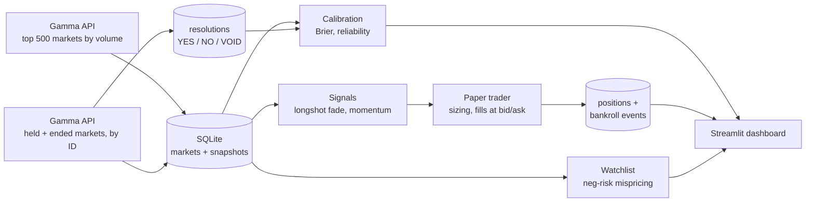

# PolyBot

[](https://github.com/JayZhangDev/PolyBot/actions/workflows/ci.yml)


PolyBot is a research pipeline for [Polymarket](https://polymarket.com) prediction markets. Every hour it snapshots the most-traded markets into SQLite, records how every market it has seen eventually resolved, and paper-trades a set of signals with a fixed bankroll.

The core question is **how well prediction-market prices forecast outcomes**. The calibration tracker scores the price each market traded at 1, 7 and 30 days before resolution against what happened (Brier score, skill vs. base rate, reliability curve), and directly tests the hypothesis behind the longshot strategy. A Streamlit dashboard shows calibration alongside the paper book, closed trades, current signals and the equity curve.

<!-- Add a dashboard screenshot: save it as docs/dashboard.png and uncomment the next line. -->
<!--  -->

## How it works



Each hourly cycle (`python -m polybot.pipeline`):

1. **Snapshot.** Fetch the 500 highest-volume open markets and store price, bid/ask, volume and liquidity.
2. **Refresh held markets.** Any market with an open paper position that wasn't in that set (usually because it closed) is fetched by ID, so resolutions are always seen.
3. **Record resolutions.** Up to 50 markets that have ended (or dropped out of the listing) are fetched by ID; closed ones are stored as YES, NO or VOID.
4. **Settle.** Positions in closed markets settle at $1 or $0 per share; the bankroll is credited.
5. **Trade.** New signals open positions at executable prices (YES at the ask, NO at 1 − bid), 1% of bankroll each, up to 10 open positions and 3 new per strategy per cycle.

## Calibration

For each resolved market and each horizon *h* (1, 7, 30 days), PolyBot takes the last YES price it recorded at least *h* days before resolution and compares it with the outcome:

- **Brier score**: mean of (price − outcome)². 0 is perfect; always guessing 50% scores 0.25.
- **Brier skill score**: 1 − Brier / Brier(base rate). Above 0 means prices beat simply predicting how often YES happens overall.
- **Reliability curve**: prices grouped into 10 buckets, average price vs. share that resolved YES. A calibrated market sits on the diagonal.
- **Longshot check**: for contracts priced at or below 0.15, average price vs. actual YES rate. If price exceeds the YES rate, longshots are overpriced and the longshot-fade signal has a basis.

Resolution time is the earlier of the market's close and the first snapshot already pinned at its final price, so markets decided early aren't scored on post-decision prices. Markets that close without a clear YES/NO (VOID) are excluded.

```bash
python -m polybot.calibration             # all horizons
python -m polybot.calibration --horizon 7
```

## Strategies

| Strategy | Rule | Rationale |
|---|---|---|
| **Longshot fade** | Buy NO when YES ≤ 0.15, volume ≥ $500k, 7+ days to resolution | The favorite–longshot bias: low-probability outcomes tend to be overpriced relative to how often they happen. |
| **Momentum** | Follow a ≥10-point YES move over ~24h, for YES between 0.15 and 0.85 | Tests whether prediction-market prices under-react to news. |
| **Mispricing watchlist** *(not traded)* | Neg-risk events where buying every leg's YES (or NO) at bid/ask costs less than its guaranteed payout | A true arbitrage needs every leg; until whole events are fetched, legs can be missing, so these are leads rather than trades. |

These are hypotheses being tested, not claims of edge. The point of the paper-trading record is to find out.

## Quickstart

```bash
git clone https://github.com/JayZhangDev/PolyBot.git
cd PolyBot
python3 -m venv .venv && source .venv/bin/activate
pip install -e ".[dev]"

python -m polybot.pipeline          # one full cycle: snapshot + paper trade
streamlit run polybot/app.py        # dashboard at http://localhost:8501
```

Other entry points:

```bash
python -m polybot.fetch --limit 100   # snapshot only
python -m polybot.signals             # print current signals and watchlist
python -m polybot.portfolio           # print bankroll summary
python -m polybot.resolutions         # one resolution sweep (--backfill for all)
```

**Upgrading an existing database?** Run `python -m polybot.resolutions --backfill` once. It checks every market that has already ended, rather than 50 per hour.

The database lives at `polybot.db` in the project root. Set `POLYBOT_DB=/path/to/file.db` to use a different one. Databases created by v0.1 are migrated in place on first run.

### Running it hourly (macOS)

Save as `~/Library/LaunchAgents/com.jayzhang.polybot.plist`, replacing the paths, then `launchctl load` it:

```xml
<?xml version="1.0" encoding="UTF-8"?>
<!DOCTYPE plist PUBLIC "-//Apple//DTD PLIST 1.0//EN" "http://www.apple.com/DTDs/PropertyList-1.0.dtd">
<plist version="1.0">
<dict>
  <key>Label</key><string>com.jayzhang.polybot</string>
  <key>ProgramArguments</key>
  <array>
    <string>/path/to/PolyBot/.venv/bin/python</string>
    <string>-m</string><string>polybot.pipeline</string>
  </array>
  <key>WorkingDirectory</key><string>/path/to/PolyBot</string>
  <key>StartInterval</key><integer>3600</integer>
  <key>StandardOutPath</key><string>/path/to/PolyBot/launchd.out.log</string>
  <key>StandardErrorPath</key><string>/path/to/PolyBot/launchd.err.log</string>
</dict>
</plist>
```

On Linux, a cron line does the same: `0 * * * * cd /path/to/PolyBot && .venv/bin/python -m polybot.pipeline`.

## Project layout

```
polybot/
  db.py            database location and connections
  fetch.py         Gamma API client (active markets, markets by ID)
  storage.py       schema, migrations, snapshot persistence
  pricing.py       executable entry prices from bid/ask
  resolutions.py   resolution sweep: how each market ended
  calibration.py   Brier score, skill score, reliability bins
  timeutil.py      timestamp parsing for API and DB formats
  signals.py       trading signals and the mispricing watchlist
  portfolio.py     bankroll ledger and position sizing
  paper_trader.py  resolution, settlement and order placement
  pipeline.py      the hourly cycle
  app.py           Streamlit dashboard
tests/             pytest suite (runs against a temporary database)
```

## Testing

```bash
pytest          # 49 tests: pricing, storage, signals, settlement, resolutions, calibration
ruff check .
```

CI runs both on every push and pull request, on Python 3.10 and 3.12.

## Roadmap

- [x] **v0.0** Gamma API fetcher and SQLite snapshot storage
- [x] **v0.1** Paper trader, three signals, Streamlit dashboard
- [x] **v0.1.1** Resolution fix for closed markets, bid/ask fills, longshot fade, tests and CI
- [x] **v0.2** Calibration tracker: resolution sweep, Brier and skill scores, reliability curve, longshot check
- [ ] **v0.3** Strategy scorecard: P&L, max drawdown and Brier score per strategy, compared with the market baseline
- [ ] **v0.4** Full-event fetching and a basket executor for neg-risk mispricings

## Limitations

- **Paper only.** No orders are sent anywhere, and fills assume the full stake executes at the top of book.
- **Fees are not modelled.** Taker fees would reduce P&L further.
- **Sample size.** Calibration needs hundreds of resolved markets per horizon before buckets are meaningful; early numbers are noisy.
- **Hourly resolution.** Moves inside the hour are invisible, and momentum compares snapshots about 20 to 24 hours apart.
- **Coverage.** Only the 500 highest-volume open markets are snapshotted each hour, plus any market currently held.

## Disclaimer

This is a research and learning project. Nothing here is financial advice, and the strategies have not been shown to be profitable.

## License

MIT. See [LICENSE](LICENSE).
