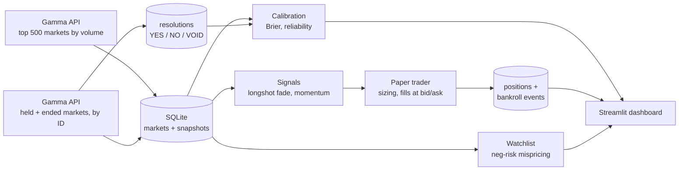

# PolyBot

[](https://github.com/JayZhangDev/PolyBot/actions/workflows/ci.yml)


PolyBot is a research project on [Polymarket](https://polymarket.com) prediction markets. It started as a data pipeline and a rule-based paper trader, and **v2 adds an autonomous agent** that estimates its own probabilities, sizes bets with the Kelly criterion, and learns from how markets resolve. Everything is paper trading; no real money is ever used.

The core question throughout is **how well prediction-market prices forecast outcomes, and whether a disciplined model can find mispricings**. The v1 calibration tracker scores market prices against outcomes; the v2 agent asks whether any market is priced far enough from a calibrated estimate to be worth a bet, and logs every decision so the answer is auditable.

## Evolution: from pipeline to agent

| Version | What it added | What it can do |
|---|---|---|
| **v0.0** | Gamma API fetcher, SQLite snapshots | Record market prices over time |
| **v0.1** | Paper trader, longshot and momentum rules, dashboard | Trade fixed rules once an hour with a flat 1% stake |
| **v0.1.1** | Executable prices (bid/ask), settlement fixes, tests, CI | Honest fills and correct P&L |
| **v0.2** | Calibration tracker | Measure how well prices predict outcomes (Brier, reliability) |
| **v2.0** | **Autonomous agent** ([`polybot/agent.py`](polybot/agent.py)) | Every 10 minutes: estimate probability per market, rank by edge, size with half-Kelly under a hard risk cap, log every decision, learn from resolutions |
| **v2.1** | Hardening: retries, run lock, rotating log, `polybot health` | Ride out API errors, record every run, and show at a glance whether data is still arriving |
| **v2.2** | Market catalog, tag-based categories, `config.yaml` | Know every open market above the floors, and choose which ones to stream |

The hourly pipeline is unchanged. The agent runs beside it, shares its market, snapshot and resolution tables, and keeps its own positions and bankroll so the two strategies can be compared cleanly. The git history shows each step.

[](https://jayzhangdev.github.io/PolyBot/)

**[Live dashboard →](https://jayzhangdev.github.io/PolyBot/)**

## How it works



Each hourly cycle (`python -m polybot.pipeline`):

1. **Snapshot.** Fetch the 500 highest-volume open markets and store price, bid/ask, volume and liquidity.
2. **Refresh held markets.** Any market with an open paper position that wasn't in that set (usually because it closed) is fetched by ID, so resolutions are always seen.
3. **Record resolutions.** Up to 50 markets that have ended (or dropped out of the listing) are fetched by ID; closed ones are stored as YES, NO or VOID.
4. **Settle.** Positions in closed markets settle at $1 or $0 per share; the bankroll is credited.
5. **Trade.** New signals open positions at executable prices (YES at the ask, NO at 1 − bid), 1% of bankroll each, up to 10 open positions and 3 new per strategy per cycle.

## Calibration

For each resolved market and each horizon *h* (1, 7, 30 days), PolyBot takes the last YES price it recorded at least *h* days before resolution and compares it with the outcome:

- **Brier score**: mean of (price − outcome)². 0 is perfect; always guessing 50% scores 0.25.
- **Brier skill score**: 1 − Brier / Brier(base rate). Above 0 means prices beat simply predicting how often YES happens overall.
- **Reliability curve**: prices grouped into 10 buckets, average price vs. share that resolved YES. A calibrated market sits on the diagonal.
- **Longshot check**: for contracts priced at or below 0.15, average price vs. actual YES rate. If price exceeds the YES rate, longshots are overpriced and the longshot-fade signal has a basis.

Resolution time is the earlier of the market's close and the first snapshot already pinned at its final price, so markets decided early aren't scored on post-decision prices. Markets that close without a clear YES/NO (VOID) are excluded.

```bash
python -m polybot.calibration             # all horizons
python -m polybot.calibration --horizon 7
```

## PolyBot v2: the autonomous agent

`python -m polybot.agent` runs one cycle; a scheduled task runs it every 10 minutes ([setup](#running-the-agent-every-10-minutes-windows--wsl)).

```mermaid
flowchart LR
    A[Gamma API<br/>2,000 active markets] --> F[Filter<br/>liquidity > $10k<br/>> 7 days left]
    F --> E[Estimator<br/>base rate + recency<br/>x category trust]
    E --> R[Rank by edge<br/>abs&#40;edge&#41; > 8%]
    R --> K[Half-Kelly sizing<br/>6% cap, 10 positions]
    K --> X[(agent_positions<br/>agent_decisions)]
    X --> L[Learning loop<br/>on resolution]
    L --> P[(agent_priors<br/>agent_performance)]
    P --> E
    X --> D[Dashboard<br/>Agent tab]
```



### 1. Scan and filter
Each cycle pulls up to 2,000 active markets (highest volume first) and keeps those with more than **$10,000 liquidity** and more than **7 days** to resolution. Eligible markets are snapshotted every 10 minutes, which gives the recency signal real price history.

### 2. Probability estimation
For each market the agent builds an ensemble estimate from three parts:

1. **Base rate (category-calibrated).** The market price is passed through a per-category calibration curve, `sigmoid(gamma * logit(price))`. `gamma = 1` means prices are calibrated; the prior `gamma = 1.1` encodes the documented favorite-longshot bias (longshots are overpriced, favorites underpriced). Markets are classified as politics, crypto, sports, science or other.
2. **Recency signal.** The price plus half of its last-24-hour move (momentum continuation). With no 24-hour history the signal equals the price and adds no edge.
3. **Calibration prior (trust).** The blend `0.6 * base + 0.4 * recency` is shrunk toward the market price by a per-category *trust* weight: `estimate = market + trust * (blend - market)`. Trust starts at 0.7 and, once 20 agent forecasts in a category have resolved, follows that category's Brier skill against the market.

The output for each market is `estimated_prob`, `market_prob` and `edge = estimated_prob - market_prob`.

### 3. Opportunity filter
Only markets with `abs(edge) > 8%` are considered, ranked by edge size.

### 4. Kelly sizing
Buying a binary share at price `c` with win probability `q` has Kelly fraction `(q - c) / (1 - c)` (edge divided by `1 - c`; equivalent to `(b*q - (1-q)) / b` with net odds `b = (1-c)/c`). The agent bets **half-Kelly**, **never more than 6% of bankroll on one market**, and **never more than 10 open positions**. `c` is the executable price (YES at the ask, NO at 1 - bid), so a trade whose edge is eaten by the spread is skipped.

### 5. Paper execution and audit trail
Every considered trade is written to `agent_decisions` (timestamp, market, question, market probability, estimate, edge, Kelly stake, action, reason, plus the estimator components as JSON). A position opens only if all rules pass; otherwise the reason is logged (`max_positions_reached`, `edge_consumed_by_spread`, `insufficient_cash`, and so on). A repeat skip for the same market is logged at most once every 6 hours so the log stays readable. Nothing is sent to any exchange.

### 6. Learning loop
Each cycle the agent first settles positions whose markets resolved (a winning share pays $1, VOID refunds the stake). It then refits each category's `gamma` on resolved markets by regularised log-loss (thin categories stay near the prior), updates trust, and writes `agent_performance` rows: agent vs market **Brier score**, **Brier skill** and **edge capture** (realized edge divided by predicted edge), by category.

### Findings so far

- **At the specified 8% threshold the agent finds nothing, and that is the honest result.** Across the first scans of about 1,300 eligible markets the largest estimated edge was **0.9%**, so no opportunities and no positions. With a conservative estimator shrunk toward the price, large edges require large evidence, and a liquid prediction market is mostly efficient. The agent is working as designed; the threshold was not loosened to produce trades.
- **The learning loop is data-starved.** PolyBot has seen only a handful of markets resolve so far, so category priors still sit at their documented defaults. Calibration and accuracy numbers appear on the dashboard as markets resolve.
- **Dry run at a 0.5% threshold** (separate database, not the real log): 10 positions opened immediately, then 412 candidates were skipped for `max_positions_reached` and 9 because the bid/ask spread consumed the edge. Sizes were small (half-Kelly of about 1% of bankroll) because the edges were.
- **Exploring lower thresholds.** `python -m polybot.agent --min-edge 0.02` runs a cycle with a different threshold. Use a separate database (`POLYBOT_DB`) for experiments so they do not mix into the main audit log.

### Dashboard: Agent tab
The static dashboard (`docs/index.html`) has an **Agent** tab with a live opportunity feed (edge bars colour-coded by size, rows pulse when a market newly clears the threshold, refreshed every 30 seconds), open positions with market vs model probability, the full decision log (filter by opened or skipped), and performance by category.

```bash
python scripts/export_dashboard.py            # writes docs/data.json (the agent task does this each cycle)
python -m http.server 8765 --directory docs   # open http://localhost:8765/#agent
```

The export also writes `paper_pnl.txt` (git-ignored): the agent's paper P&L, equity minus its $1,000 start, as one number on one line, for a local desktop wallpaper to read.

### Running it on a schedule (Windows + WSL)

The three jobs run as Windows scheduled tasks that call into WSL. One script installs them:

```powershell
powershell -ExecutionPolicy Bypass -File scripts\install_tasks.ps1
```

| Task | Runs | What it does |
|---|---|---|
| `PolyBot-Hourly` | every hour at five past | [`scripts/run_pipeline.sh`](scripts/run_pipeline.sh): one pipeline cycle |
| `PolyBot-Agent` | every 10 minutes | [`scripts/run_agent.sh`](scripts/run_agent.sh): one agent cycle, then a dashboard export |
| `PolyBot-Discover` | every 15 minutes | [`scripts/run_discover.sh`](scripts/run_discover.sh): refresh the market catalog |

**Reloading.** After editing `install_tasks.ps1`, run the same command again; it replaces all three tasks. Code changes need no reload, because each run starts a fresh Python process.

```powershell
Get-ScheduledTask PolyBot-* | Disable-ScheduledTask      # pause
Get-ScheduledTask PolyBot-* | Enable-ScheduledTask       # resume
Get-ScheduledTask PolyBot-* | Get-ScheduledTaskInfo      # last run time and result
```

**The PC must be awake and logged in.** The tasks survive a reboot (they start again at login, and a missed run fires straight away), but nothing can run while the PC is asleep or shut down. Every hour of sleep is an hour with no data. Keep it plugged in with sleep turned off, or wait for the always-on option on the roadmap.

### Health, logs and failures

```powershell
powershell -ExecutionPolicy Bypass -File scripts\health.ps1     # from Windows
python -m polybot health                                        # from inside WSL, or anywhere the bot runs
```

Example output (your numbers will differ):

```
PolyBot health at 2026-11-11 21:40 UTC

Last successful fetch : 2026-11-11 21:34 UTC (6 min ago)  [OK]
Rows added, last 24h  : 228,333 snapshots across 1,812 markets
Longest gap, last 24h : 61 min with no data

Runs in the last 24h:
  agent      143 ok    1 failed   last success 2026-11-11 21:34 UTC
  pipeline    24 ok    0 failed   last success 2026-11-11 21:06 UTC

Errors in the last 24h:
  2026-11-11 10:30 UTC  agent     FetchError: https://gamma-api.polymarket.com/markets ... failed after 5 tries: HTTP 500
```

The command exits with code 1 when the newest snapshot is more than 30 minutes old.

- **Log.** Every run writes timestamped lines to `logs/polybot.log`. The file rotates at about 2 MB and five old files are kept. `logs/task_output.log` only receives output from a run that crashed before logging started.
- **Retries.** A request that fails with a network error or a 5xx status is retried up to four times, waiting 1s, 2s, 4s then 8s ([`polybot/http.py`](polybot/http.py)). If a later page of the market listing still fails, the pages already loaded are kept.
- **One job at a time.** The pipeline and the agent share one SQLite file, so a lock file (`polybot.db.lock`) makes the second job wait for the first. A lock older than 12 minutes belongs to a run that was killed and is taken over.
- **Every run is recorded.** The `job_runs` table holds the start, finish, status and error of each run. A run that crashes is recorded as failed and the next one starts normally.

## Market catalog and `config.yaml`

Polymarket has more than 90,000 open markets, and most hold almost no money: on 2026-11-11 only about 1,800 had at least $10,000 of liquidity and $50,000 of volume. Every 15 minutes the discovery job ([`polybot/discovery.py`](polybot/discovery.py)) lists the open markets that pass those two floors and stores one row of metadata for each in the `market_catalog` table: question, category, end date, outcomes, token IDs, volume and liquidity.

- **Floors are applied by Polymarket, not after downloading.** The two numbers are sent with the request, so a refresh is about 20 pages and 15 seconds instead of 900+ pages. Set both to 0 to list everything.
- **Paging uses cursors.** Each response from `/markets/keyset` carries a `next_cursor` for the following page. The older offset paging is being retired and refuses large offsets; the pipeline and the agent use the cursor endpoint too.
- **Categories come from Polymarket's tags.** A market carries many tags, so [`CATEGORY_TAGS`](polybot/discovery.py) is checked in order and the first match wins, narrow categories before broad ones (an Iran market tagged both `geopolitics` and `politics` is geopolitics). Anything unmatched is `other`.

[`config.yaml`](config.yaml) holds the choices. Every line is optional, and a misspelled name is reported instead of ignored:

```yaml
filters:
  min_liquidity: 10000      # dollars of resting orders
  min_volume: 50000         # dollars traded over the market's life
  include_categories: []    # empty means all; example: [politics, geopolitics]
  skip_categories: []       # example: [sports, mentions]

stream:
  max_markets: 300          # how many markets to stream live
  rank_by: volume           # volume, volume_24h or liquidity
```

```bash
python -m polybot discover    # refresh the catalog now
python -m polybot markets     # show the catalog and what the settings select
```

Example output of `markets` (your numbers will differ):

```
Catalog  : 1,812 open markets with liquidity >= $10,000 and volume >= $50,000 (refreshed 0 min ago)
Selected : 300 to stream (max 300, top by volume)

Category      catalog  selected
  politics        512       175
  geopolitics     467        63
  sports          349        16
  crypto          180        20
  finance         127         2
  economics        56        19
  culture          51         4
  tech             50         0
  weather          14         1
  science           4         0
  other             2         0

Top 10 selected:
  $   79,768,842 vol  $   375,574 liq  geopolitics Will the U.S. invade Iran before 2027?
  $   67,107,370 vol  $   446,567 liq  culture     Will Jesus Christ return before 2027?
  $   55,187,135 vol  $ 2,178,333 liq  politics    Will LeBron James win the 2028 US Presidential Election?
  $   54,667,909 vol  $ 2,729,980 liq  politics    Will Oprah Winfrey win the 2028 Democratic presidential nomination?
  $   52,979,279 vol  $   206,456 liq  politics    Will Bernie Sanders win the 2028 Democratic presidential nomination?
  $   51,133,396 vol  $   180,827 liq  politics    Will Chelsea Clinton win the 2028 Democratic presidential nomination?
  $   49,274,155 vol  $ 2,065,622 liq  politics    Will Andrew Yang win the 2028 Democratic presidential nomination?
  $   46,198,977 vol  $   513,810 liq  geopolitics Will China invade Taiwan by end of 2026?
  $   45,881,604 vol  $ 1,757,982 liq  politics    Will the US confirm that aliens exist before 2027?
  $   44,989,642 vol  $ 2,262,800 liq  politics    Will Tim Walz win the 2028 US Presidential Election?
```

A market can be selected only if it is accepting orders and has exactly two outcome tokens. The streamer that uses this selection is the next step on the roadmap.

## Strategies (v1 pipeline)

| Strategy | Rule | Rationale |
|---|---|---|
| **Longshot fade** | Buy NO when YES ≤ 0.15, volume ≥ $500k, 7+ days to resolution | The favorite–longshot bias: low-probability outcomes tend to be overpriced relative to how often they happen. |
| **Momentum** | Follow a ≥10-point YES move over ~24h, for YES between 0.15 and 0.85 | Tests whether prediction-market prices under-react to news. |
| **Mispricing watchlist** *(not traded)* | Neg-risk events where buying every leg's YES (or NO) at bid/ask costs less than its guaranteed payout | A true arbitrage needs every leg; until whole events are fetched, legs can be missing, so these are leads rather than trades. |

These are hypotheses being tested, not claims of edge. The point of the paper-trading record is to find out.

## Quickstart

```bash
git clone https://github.com/JayZhangDev/PolyBot.git
cd PolyBot
python3 -m venv .venv && source .venv/bin/activate
pip install -e ".[dev]"

python -m polybot.pipeline          # one full cycle: snapshot + paper trade
streamlit run polybot/app.py        # dashboard at http://localhost:8501
```

Other entry points:

```bash
python -m polybot.fetch --limit 100   # snapshot only
python -m polybot.signals             # print current signals and watchlist
python -m polybot.portfolio           # print bankroll summary
python -m polybot.resolutions         # one resolution sweep (--backfill for all)
python -m polybot health              # last fetch, rows added in 24 hours, recent errors
python -m polybot discover            # refresh the market catalog
python -m polybot markets             # what config.yaml selects for streaming
```

**Upgrading an existing database?** Run `python -m polybot.resolutions --backfill` once. It checks every market that has already ended, rather than 50 per hour.

The database lives at `polybot.db` in the project root. Set `POLYBOT_DB=/path/to/file.db` to use a different one. Databases created by v0.1 are migrated in place on first run.

### Running it hourly (macOS)

Save as `~/Library/LaunchAgents/com.jayzhang.polybot.plist`, replacing the paths. `RunAtLoad` starts it at login, so it survives a reboot. The Mac must be awake: launchd does not run jobs during sleep.

```xml
<?xml version="1.0" encoding="UTF-8"?>
<!DOCTYPE plist PUBLIC "-//Apple//DTD PLIST 1.0//EN" "http://www.apple.com/DTDs/PropertyList-1.0.dtd">
<plist version="1.0">
<dict>
  <key>Label</key><string>com.jayzhang.polybot</string>
  <key>ProgramArguments</key>
  <array>
    <string>/path/to/PolyBot/.venv/bin/python</string>
    <string>-m</string><string>polybot.pipeline</string>
  </array>
  <key>WorkingDirectory</key><string>/path/to/PolyBot</string>
  <key>StartInterval</key><integer>3600</integer>
  <key>RunAtLoad</key><true/>
  <key>StandardOutPath</key><string>/path/to/PolyBot/launchd.out.log</string>
  <key>StandardErrorPath</key><string>/path/to/PolyBot/launchd.err.log</string>
</dict>
</plist>
```

Load it, and reload it after any edit to the file:

```bash
launchctl unload ~/Library/LaunchAgents/com.jayzhang.polybot.plist 2>/dev/null
launchctl load -w ~/Library/LaunchAgents/com.jayzhang.polybot.plist
launchctl list | grep polybot      # second column is the last exit code; 0 means the last run was fine
```

On Linux, a cron line does the same: `0 * * * * cd /path/to/PolyBot && .venv/bin/python -m polybot.pipeline`.

## Project layout

```
polybot/
  db.py            database location and connections
  http.py          GET with retries and exponential backoff
  fetch.py         Gamma API client (active markets, markets by ID)
  config.py        settings from config.yaml, with defaults and clear errors
  discovery.py     list every open market above the floors; tags to categories
  catalog.py       market_catalog table and the choice of markets to stream
  storage.py       schema, migrations, snapshot persistence
  pricing.py       executable entry prices from bid/ask
  resolutions.py   resolution sweep: how each market ended
  calibration.py   Brier score, skill score, reliability bins
  timeutil.py      timestamp parsing for API and DB formats
  signals.py       trading signals and the mispricing watchlist
  portfolio.py     bankroll ledger and position sizing
  paper_trader.py  resolution, settlement and order placement
  pipeline.py      the hourly cycle (v1, unchanged)
  agent.py         the 10-minute autonomous agent (v2)
  jobs.py          job lock and the job_runs record of every scheduled run
  logsetup.py      rotating log file with UTC timestamps
  health.py        the `polybot health` report
  cli.py           the `polybot` command
  app.py           Streamlit dashboard
config.yaml        filters and limits (no secrets)
scripts/           dashboard export, job runners, scheduler installer, health check
tests/             pytest suite (temporary database, no network)
tests/fixtures/    real Gamma API responses saved for the parser tests
```

## Testing

```bash
pytest          # 219 tests: pricing, storage, signals, settlement, resolutions, calibration,
                # the agent (Kelly sizing, estimator, risk rules, settlement, learning),
                # retries, the job lock, health, settings, discovery and the catalog,
                # and parsers against saved API responses
ruff check .
```

CI runs both on every push and pull request, on Python 3.10 and 3.12.

## Roadmap

- [x] **v0.0** Gamma API fetcher and SQLite snapshot storage
- [x] **v0.1** Paper trader, three signals, Streamlit dashboard
- [x] **v0.1.1** Resolution fix for closed markets, bid/ask fills, longshot fade, tests and CI
- [x] **v0.2** Calibration tracker: resolution sweep, Brier and skill scores, reliability curve, longshot check
- [x] **v2.0** Autonomous agent: probability ensemble, 8% edge filter, half-Kelly with 6% cap, decision audit log, learning loop, Agent tab
- [x] **v2.1** Hardening: retries with backoff, job lock, run records, rotating log, `polybot health`
- [x] **v2.2** Market catalog: cursor paging, tag-based categories, `config.yaml` filters, stream selection
- [ ] **v0.3** Strategy scorecard: P&L, max drawdown and Brier score per strategy, compared with the market baseline
- [ ] **v0.4** Full-event fetching and a basket executor for neg-risk mispricings

## Limitations

- **Paper only.** No orders are sent anywhere, and fills assume the full stake executes at the top of book. A trade is skipped when the side it needs has no quote; nothing is ever filled at the midpoint.
- **Fees are not modelled.** Taker fees would reduce P&L further.
- **Sample size.** Calibration needs hundreds of resolved markets per horizon before buckets are meaningful; early numbers are noisy.
- **Hourly resolution (v1).** Moves inside the hour are invisible to the pipeline, and its momentum signal compares snapshots about 20 to 24 hours apart.
- **Agent evidence.** The agent's recency signal needs 24 hours of its own 10-minute snapshots before it contributes, and its calibration priors need many resolved markets before they move from the documented defaults.
- **Coverage.** The pipeline snapshots the 500 highest-volume open markets each hour, plus any market currently held. The agent scans up to 2,000. The catalog knows every open market above the floors in `config.yaml`, but it stores metadata only; prices are still recorded by the pipeline and the agent.

## Disclaimer

This is a research and learning project. The agent is paper-only: it has no wallet, no keys and no order-placement code. Nothing here is financial advice, and the strategies have not been shown to be profitable.

## License

MIT. See [LICENSE](LICENSE).
